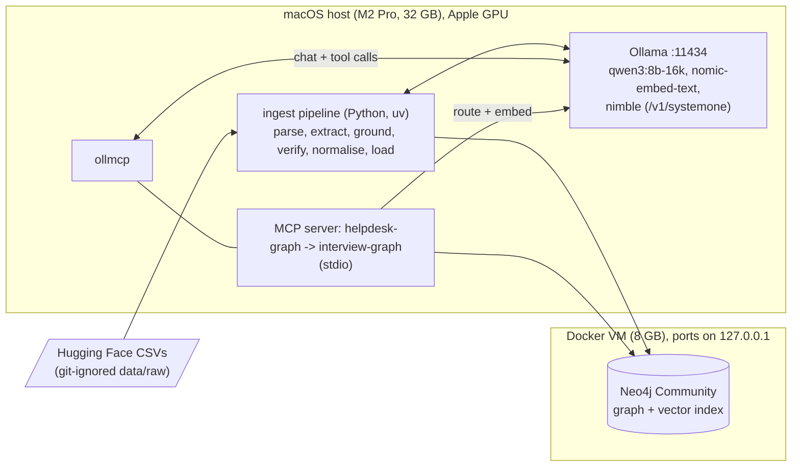
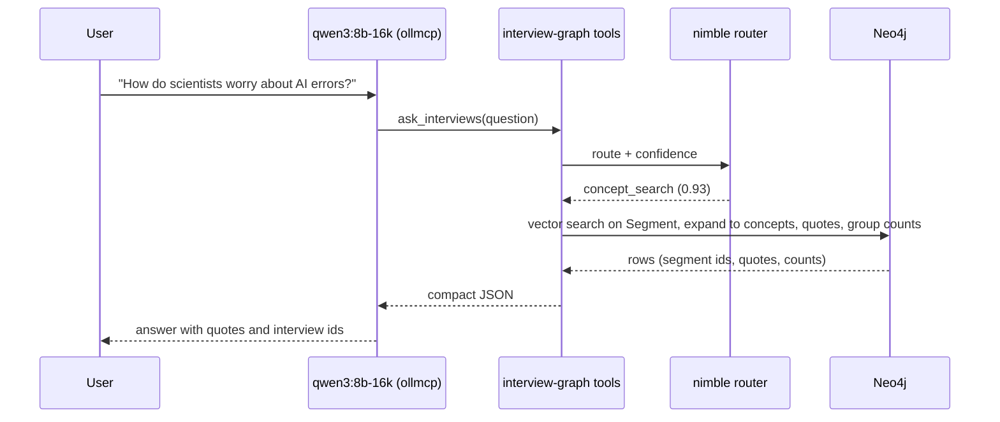

# 02. Architecture

## Components

Qdrant and Phoenix are no longer required ([ADR-0011](decisions/0011-retrieval-in-neo4j.md)). Tracing can be added later (OpenTelemetry to Phoenix) but is not on the critical path.

## Two flows

**Build (offline, hours):** CSV, parse segments, `qwen3` extraction per transcript, grounding, `nimble` verification and typed attributes, embedding and normalisation, `MERGE` into Neo4j, theme detection.
Each stage writes a rebuildable artefact keyed by `run_id`, `model`, `prompt_version` so a bad stage can be rerun alone.

**Query (interactive):**

## Routes (decided by `nimble`, see [04](04-query-and-tools.md))

`local_search`, `concept_stats`, `compare_groups`, `theme_overview` (global), `evidence`, `out_of_scope`. Below the confidence threshold the tool asks the user to rephrase.

## Resource budget

| Consumer | Where | Memory |
|---|---|---|
| qwen3:8b-16k | host | 7.4 GB loaded at 16k context (from `ollama ps`) |
| nimble | host | 9.3 GB on disk |
| nomic-embed-text | host | 0.3 GB |
| Neo4j (heap 1 GB, page cache 512 MB) | Docker | about 2 GB |
| `qwen2.5:32b` (offline theme summaries and judge) | host | 19 GB, run alone |

During the build, qwen3 and nimble are used one after another, not together, to keep timings clean. At query time both are resident; set `OLLAMA_MAX_LOADED_MODELS=2`.

## Failure handling

| Failure | Behaviour |
|---|---|
| Neo4j down | Tools return an error; the model says the graph is unavailable. |
| Router below confidence threshold | Ask for clarification; run nothing. |
| No segment above a similarity floor | Say nothing relevant was found; do not guess. |
| Extraction stage crash | Resume from the last written artefact (idempotent stages). |
| Model passes bad arguments | Tools validate enums and clamp limits. |

Code layout (proposed): `src/graphrag/{parse,extract,ground,verify,normalise,load,queries,mcp_server}.py`, `spike/` (existing), `eval/`, `docs/`, `docker-compose.yml`, `mcp.json`.
