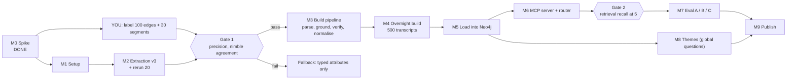

# 07. Implementation roadmap

Turns the phases in [06](06-evaluation-and-roadmap.md) into ordered build steps. **All durations are my estimates**, except the run times that come from [spike 01](spike-01-extraction.md).
Effort is for one person; "machine" time runs unattended.

## The road

## Milestones

| # | Milestone | Deliverables (files) | Done when | Effort |
|---|---|---|---|---|
| M0 | Spike | `spike/01..06`, [spike 01](spike-01-extraction.md), label sheets | Done | done |
| M1 | **Done 2026-11-05** (see outcome below). Project setup | `pyproject.toml` (uv, Python 3.12), `docker-compose.yml` (Neo4j only), `.env.example`, `src/graphrag/config.py`, constraints script | `docker compose up -d` healthy; `RETURN 1` over Bolt; ports on 127.0.0.1; `.gitignore` covers `data/` and `.env` | 1 to 2 h |
| L | **Your labelling** (parallel with M1, M2) | filled `data/labeling/*.csv`; run `spike/06_score_labels.py` | Edge precision and `nimble` agreement numbers exist | 2 to 3 h you |
| M2 | **Done 2026-11-05** (see outcome below). Extraction v3 | `src/graphrag/extract.py`: `status` field (`current/hypothetical/desired`), one list for phrases, no examples, prompt-hygiene check | Rerun of the same 20 transcripts: 20/20 valid JSON, hygiene passes, fewer `hypo` than v2 | 3 to 4 h, 10 min machine |
| G1 | **Gate 1: waived for the demo, not passed ([ADR-0013](decisions/0013-waive-human-labels.md))** (provisional LLM labels: v3.2 edge precision 0.74, CI 0.65 to 0.82, in the 0.60 to 0.80 band; `nimble` attitude agreement 0.63; see [spike 01 addendum 2](spike-01-extraction.md); human confirmation still pending) | decision note appended to [ADR-0010](decisions/0010-extraction-pipeline.md) | Lenient precision after the status filter at least 0.80 on a fresh 100-edge label round (reuse `05_make_label_sheets.py` with the v3 file), grounding at least 90% (fuzzy); otherwise take the fallback | 1.5 h you + 0.5 h |
| M3 | **Done 2026-11-06** (see outcome below). Build pipeline | `parse.py`, `ground.py` (fuzzy match), `verify.py` (`nimble` yes/no per item), `attributes.py` (`topic` first, then attitude only where relevant), `normalise.py` (nomic embeddings, clustering, alias table), run manifest keyed by `run_id`/`model`/`prompt_version` | Stages resumable and idempotent; unit tests for parse, ground, key normalisation | 1 to 1.5 days |
| M4 | **Done 2026-11-06/07 (run id `demo1`; see "M4 outcome")**. Overnight build | artefacts in `data/artefacts/` for 500 transcripts (all creatives and scientists, 250 workforce, fixed seed) | Extraction about 4.3 h plus verify and attributes (a few more hours, unmeasured); failure log empty or explained | machine, overnight |
| M5 | **Done 2026-11-07 (see "M5 outcome")**. Load | `load.py` (batched `UNWIND`/`MERGE`), vector index, post-load count checks | Node counts match artefacts; 100% of extracted edges have a grounded quote; reload changes nothing | 0.5 day |
| M6 | **Done 2026-11-07 (see "M6 outcome")**. MCP server and router | `queries.py` (parameterised, read mode), `router.py` (`/v1/systemone`, confidence gate), `mcp_server.py` with `ask_interviews` plus typed tools, `mcp.json` | `ollmcp --servers-json mcp.json --model qwen3:8b-16k` lists the tools; each route answers a smoke question; out-of-scope calls nothing | 1 day |
| G2 | **Gate 2: passed on a proxy (see "M6 outcome")** | retrieval check | Recall at 5 of at least 0.7 on your 10 retrieval queries; otherwise add the full-text index (ADR-0011) | 1 to 2 h incl. your query list |
| M7 | **Done 2026-11-07 (see "M7 outcome" and [08](08-evaluation-results.md))**. Evaluation | `eval/` question sets (40 routes, held-out half), configs A (qwen3 picks tools), B (router), C (plain vector RAG), results table | Table with route accuracy, abstention, quote validity, number groundedness, latency; honest note where the graph did not help | 1 to 1.5 days |
| M8 | **Done 2026-11-07 (see "M8 outcome")**. Themes | `themes.py` (community detection on canonical-concept co-occurrence, in Python), offline summaries with `qwen2.5:32b` run alone | `theme_overview` answers from stored summaries, each citing member concepts and counts | 0.5 day + machine time |
| M9 | **Done 2026-11-07 (see "M9 outcome")**. Publish | README (credit and link to the dataset and Anthropic post, CC-BY reading, sample limits), PII pass note, pre-push check that fails on any tracked `data/` path | `git ls-files` contains no transcript text or artefacts; short excerpts only | 0.5 day |

Estimated total: about **5 to 7 working days** of effort plus roughly one or two overnight machine runs. These are planning guesses, not measurements.

## Critical path and parallel work

- Critical path: M1, M2, Gate 1, M3, M4, M5, M6, M7, M9.
- Do while the machine runs M4: write `queries.py`, `router.py` and the eval question set (CPU-light; do not load other models, which would distort and slow the GPU run).
- Your labelling (L) can start now; it only blocks Gate 1.
- Run builds one model at a time: qwen3 for extraction, then `nimble`, then embeddings. Unload with `ollama stop <model>` between stages.

## Decision points and fallbacks

| If | Then |
|---|---|
| Gate 1 lenient precision under 0.60 after the status filter | Drop open extraction; keep `nimble` typed attributes per segment (attitude, topic, job worry) and vector retrieval only; the graph shrinks to Group, Interview, Segment |
| Gate 1 between 0.60 and 0.80 | Tighten the verify threshold, accept lower recall, report the numbers |
| Normalisation yields a long tail (most canonical nodes with one mention) | Count at the `Theme` level only; present concept lists as exploratory |
| Router abstains on more than about 30% of eval questions | Tune threshold on the held-in half; test `tev1`; otherwise fall back to config A |
| Run time doubles | Cut `workforce` sample to 100 or verify only a sample of items |
| Recall at 5 under 0.7 | Add the full-text index, then a reranker |

## First three actions

1. Fill the two label sheets ([guide](labeling-guide.md)).
2. M1: `uv init`, add `docker-compose.yml` from [05](05-components.md), verify a Neo4j 5 Community tag actually pulls, create `.env` and constraints.
3. M2: copy `spike/02b_extract_v2.py` into `src/graphrag/extract.py` and add the `status` field, then rerun the 20.

## Not on the road (deliberately)

Qdrant, Phoenix tracing, text-to-Cypher, the 32b model as extractor, all 1,250 transcripts, the helpdesk variant. Each can be added later with its own decision record.

## M1 outcome (2026-11-05)

Verified, not assumed:

| Check | Result |
|---|---|
| `neo4j:5.26-community` pulls on this Mac | Yes; arm64 manifest exists; running kernel `5.26.32`, edition `community` |
| Container health | `healthy` via `cypher-shell` healthcheck |
| Network exposure | Bolt 7687 and Browser 7474 listen on `127.0.0.1` only; Browser returns HTTP 200 |
| `RETURN 1` over Bolt from the host | 1 |
| Memory | 1.43 GB of the 7.65 GB Docker VM after schema creation (heap 1 GB, page cache 512 MB) |
| Schema | 8 uniqueness constraints and the `segment_embedding` vector index (768-d, asked from `nomic-embed-text`, not hard-coded) |
| Tests | 2 passed (`tests/test_schema.py`) |
| Community limits | `CREATE USER` works (a probe user was created and dropped). `CREATE ROLE`, `GRANT ROLE`, `SHOW ROLES` are **unsupported**, so there is no database-level read-only role |
| Read mode | A write in a `default_access_mode=READ` session is rejected by the server (`Writing in read access mode not allowed`). Enforcement depends on the application choosing READ |

Files added: `pyproject.toml`, `docker-compose.yml`, `.env.example`, `.env` (git-ignored, generated password), `src/graphrag/{__init__,config,schema}.py`, `tests/test_schema.py`.

Changes from the plan: the compose healthcheck derives the password from `NEO4J_AUTH` (a `NEO4J_PASSWORD` variable inside the container would be parsed as a Neo4j setting); APOC is not installed because no query needs it; transaction timeout is 30 s.

Next: M2 (extraction v3). Gate 1 still needs your labels.

## M2 outcome (2026-11-05)

Code: `src/graphrag/{parse,ground,extract}.py`, `scripts/run_m2.py`, `scripts/compare_m2.py`, `tests/test_pipeline_core.py` (11 tests pass). Artefacts in git-ignored `data/artefacts/` (`m2_v3_looped.jsonl`, `m2_v3.1.jsonl`, `m2_v3.2.jsonl`).

What changed from the spike prompt, each tied to a labelled error: one list with a required `kind` (`work_task | ai_use | concern`) so a phrase has one home; `status` (`current | hypothetical | desired`); `polarity` (`affirmed | negated`);
no examples in the prompt; grounding against participant turns only, with a fuzzy match (threshold 0.9) that also finds the segment; de-duplication; an item cap and a token cap.

Final run (v3.2, same 20 transcripts):

| Measure | v3.2 | Spike v2 |
|---|---|---|
| Valid JSON | 20 of 20 | 20 of 20 |
| Prompt-hygiene failures | none | n/a (contamination found by hand in v1) |
| Quote grounding | 97.1% fuzzy, participant turns only (303 of 312) | 83.0% exact |
| Items per transcript | 15.6 (312 total after de-duplication; 342 raw) | 14.5 |
| Mean time per transcript | **44.9 s** (median 41.6, max 75.3) | 31 s |
| Projected extraction time | **6.2 h for 500**, 15.6 h for 1,250 | 4.3 h and 10.8 h |
| Kinds | ai_use 182, concern 101, work_task 29 | n/a |
| Status | current 244, desired 32, hypothetical 36 | n/a |
| Polarity | affirmed 289, negated 23 | n/a |
| Transcripts that still hit the 25-item cap (raw) | 4 of 20 | n/a |

Against my 26 labelled v2 errors (LLM labels, [spike 01 addendum](spike-01-extraction.md)): none survives as a current, affirmed item of the same kind. Of the 7 hypotheticals, 6 are now flagged and 1 is dropped.
Of the 10 kind errors, 4 are dropped and 6 moved to a different kind. Of the 9 other errors, 7 are dropped and 2 flagged. **This is in-sample**: I designed the changes from those same errors, so it overstates the real improvement.
Of the 74 edges I labelled `ok`, 38 are matched and kept, 4 are now flagged (some correctly, such as a negated "trust in AI grading"), and 32 have no matching quote in v3.2. That last number is a **possible recall loss** (or a different quote for the same fact); it is not measured.

Problems found on the way:

1. **Runaway generation.** The first v3 run hung for over ten minutes on one transcript (the model server pegged at over 200% CPU); the v3 rerun showed 4 transcripts looping to the 40-item cap with repeated quotes (98 of 391 items were duplicates).
   Fixed with a schema item cap, a token cap (`num_predict`), `truncated` and `n_raw_items` flags, a resumable runner, and de-duplication. Four transcripts still loop to the cap, so the loop is reduced, not gone.
2. **My own prompt line caused slowness.** "Give the 25 most important items at most" anchored the model to produce more: one transcript went 55 s to 27 s after removing it. The schema cap was not the cause (47 s with or without it).
3. **Slower than the spike** (44.9 s vs 31 s) because each item now has more fields, and loops cost 60 to 75 s each. The 500-transcript extraction budget is about 6 h, not 4.3 h.
4. **Names are inconsistent**: some come out as `snake_case` (`idea_sounding_board`). The M3 normaliser should replace underscores and lower-case before embedding.
5. `work_task` is only 9% of items; the interview focuses on AI, so most "work" shows up as AI uses. Do not expect a rich task graph.

Not done: a fresh human (or independent) precision measurement on v3.2 output. Gate 1 needs one; see below.

**Next:** Gate 1. The v3.2 sheets are generated in `data/labeling_v3/` (`scripts/make_label_sheet_v3.py`); follow [labeling-guide.md](labeling-guide.md) and score with `scripts/score_labels_v3.py`, then proceed to M3. The human labelling has not happened yet.

## M3 outcome (2026-11-06)

Gate 1 was waived ([ADR-0013](decisions/0013-waive-human-labels.md)), so M3 started from the LLM-estimated 0.74 precision and put the first fixes into code.

Code (22 tests pass): `src/graphrag/{decision,manifest,verify,attributes,normalise,pipeline}.py` plus the M2 modules; `scripts/calibrate_verify.py`; prompt `v3.3`. Entry point:
`PYTHONPATH=src uv run python -m graphrag.pipeline --run-id <id> --scope demo --stage all` (stage-major: extract, then verify, then attributes, then normalise and assemble; resumable per transcript; unloads each model before the next).

End-to-end run on 5 transcripts (scope `tiny`: 2 workforce, 2 creatives, 1 scientist), real models:

| Stage | Measured | Projected for the 500-transcript demo scope |
|---|---|---|
| Extract (`qwen3:8b-16k`, v3.3) | 42.8 s per transcript, 76 items (15.2 each), 0 hygiene failures, 0 truncated | about 5.9 h |
| Verify (`nimble`) | 16 s per transcript (about 1.05 s per item); 11 of 76 items under `supports` 0.2 | about 2.3 h |
| Attributes (`nimble`, attitude only) | 1.66 s per segment, 50 segments | about 2.7 h (5,800 segments, estimated) |
| Normalise, assemble | seconds | negligible |
| **Total** | | **about 11 hours**, spread over one or two nights; extrapolated from 5 transcripts, so treat as plus or minus 30% |

Resumability was tested: copying the extract and verify results into a new run id and rerunning skipped them, and attitudes recomputed for 36 segments matched the earlier run in 35 (the one flip is a sign of ordinary instability at the choice boundary).

Findings that changed the design:

1. **Verify catches one error type well.** It separates unsupported names from good ones, not wrong status or wrong kind (details in [ADR-0010 amendments](decisions/0010-extraction-pipeline.md)). Expected precision after the filter is about 0.80, LLM-estimated and in-sample.
2. **Topic gating of attributes saved nothing** (36 of 50 segments needed the second call) and job-worry fired once in 50: dropped, cutting attributes from 2.8 s to 1.66 s per segment.
3. **Normalisation needs the word "ai" removed before embedding**, or generic phrases collapse into catch-all clusters (22 names in one at 0.85).
4. **Names still rarely repeat.** At 0.85, about a fifth of the 306 distinct names merge. Counts by concept will be small for most concepts; expect a long tail, and lean on themes (M8) for overview questions.
5. **Cache caution:** repeated identical `nimble` requests return in a fraction of a second, so benchmark with fresh inputs; I nearly misread a 0 s stage as a bug.

Not done in M3: nothing is loaded into Neo4j yet (M5); the 500-transcript build (M4) has not been run. Output of this run is in git-ignored `data/artefacts/tiny1` and `tiny2`.

## M4 status (started 2026-11-06)

Launched `python -m graphrag.pipeline --run-id demo1 --scope demo --stage all` under `caffeinate -i` on AC power: 500 transcripts (125 creatives, 125 scientists, 250 workforce), expected about 11 hours. First transcripts took 29 to 35 s each.
Output goes to git-ignored `data/artefacts/demo1/` (`extract.jsonl`, `verify.jsonl`, `attributes.jsonl`, `normalise.json`, `graph_input.jsonl`). If the process stops, rerun the same command; finished transcripts are skipped.

## M4 outcome (done; finished 2026-11-06 22:51 local)

Result: all 500 transcripts went through extract, verify, attributes and normalise; `graph_input.jsonl` has 500 interview records. Output is in git-ignored `data/artefacts/demo1/`. Logs: `data/pipeline_demo1.part1.log` (up to the interruption) and `data/pipeline_demo1.log` (resumed run).

| Measure | Result |
|---|---|
| Transcripts | 500 (125 creatives, 125 scientists, 250 workforce) |
| Extract | 500/500; 500 valid JSON, 0 truncated |
| Edges extracted, then kept by verify (`supports >= 0.2`) | 6,738, then 5,000 (74%) |
| Canonical nodes after normalise | 4,312 (2,535 AI uses, 1,240 concerns, 537 work tasks) |
| Errors or tracebacks in either log | 0 |
| Wall time | 12:07 to 22:51, 10 h 44 min, including the interruption |
| Compute per stage | extract 6.5 h (mean 46.8 s per transcript), verify 1.9 h (about 13 to 15 s), attributes 2.3 h (about 17 s) |

Against the projection (about 11 h total): total compute (10.7 h) was close, but extraction took 6.5 h against 5.9 h projected (mean 46.8 s versus about 42 s), while verify and attributes were slightly faster than projected.

### Finding: the run was interrupted once, 2026-11-06 19:44:41

- **When:** the last progress line was `[verify 311/500]` at 19:44:34 local time. The whole process group (`uv`, `caffeinate`, Python; pids 88963 to 88965) exited together at 19:44:41, after 7 h 37 min of running.
- **Cause: not determined.** The evidence rules out some candidates but does not name the cause:
  - No traceback or error in the log; the process was killed from outside rather than failing.
  - No sleep, wake or lid event in `pmset -g log`; `caffeinate` was holding its assertion until the exit.
  - No memory-pressure kill of the process (the jetsam events near that time were unrelated system daemons).
  - Not the 10-minute timeout I had set on the background launch: it had already run 7 h 37 min.
  - Most likely the tool session that launched it ended the child processes (the launch was a child of the assistant session, not detached). This is an inference.
- **Impact:** none on data. The manifests ignore half-written lines, so a rerun resumed at verify 313/500. The first restart attempt failed (macOS has no `setsid`), and the working restart began at about 19:46. The gap was under two minutes.
- **Lesson:** launch long runs detached from the session: `(PYTHONPATH=src nohup caffeinate -i uv run python -m graphrag.pipeline ... < /dev/null &)`.

### Caveats carried forward

- Precision is still LLM-estimated (about 0.74 before verify, about 0.80 after; single rater, in-sample threshold).
- Recall is unmeasured.
- About a fifth of distinct names merge at 0.85, so most concept counts are small.
- Attitude agreement with the larger model was 0.63 in M3.

## M5 outcome (done 2026-11-07)

`src/graphrag/load.py` loads `data/artefacts/demo1/graph_input.jsonl` into Neo4j with `MERGE` throughout. Run: `PYTHONPATH=src uv run python -m graphrag.load --run-id demo1`. Segment text comes from the raw CSV (the artefact holds only indexes); each segment is embedded as `search_document: <question>\n<answer>` and cached in `data/artefacts/demo1/segment_embeddings.jsonl` (about 1.5 min for 5,450 segments). Tests: 25 pass (3 new, in `tests/test_load.py`).

| Check | Result |
|---|---|
| Interviews, segments | 500, 5,450 (all with an embedding) |
| `DOES_TASK` / `USES_AI_FOR` / `RAISES` edges | 600 / 3,020 / 1,358 (5,000 loaded of 5,000 kept) |
| `Task` / `AIUse` / `Concern` nodes | 367 / 1,217 / 686 (Concern became 967 after the 2026-11-09 concern pass, below) |
| Graph total | 8,223 nodes, 10,928 relationships |
| Every edge has a quote; no orphan concept; vector index ONLINE | pass |
| Reload changes nothing | pass (counts identical after a second run) |
| Quote re-grounded against the segment's answer at load | 0 dropped |

Notes:
- **22 of the 5,000 kept edges (0.4%) have no `segment_idx`** (the quote could not be placed in a single answer), so the loader skips them: the loaded edge count is therefore 4,978, which is what the table shows (600 + 3,020 + 1,358). They stay in the artefact.
- **Counts are small**, as expected: the most frequent concern, "hallucinations", has 33 mentions across 500 interviews; the most frequent AI use, "brainstorming", has 73.
- **Not built in M5:** `Occupation` nodes (the v3 extractor dropped `role_guess`) and `Theme` nodes (M8).
- **Early retrieval observation for Gate 2 (M6):** a vector search for "worried about losing creative skills" returned two relevant answers and one irrelevant short answer ("I don't think so."), because short replies inherit meaning from the question. Retrieval recall is still unmeasured.

## M6 outcome (done 2026-11-07) and Gate 2

Built: `queries.py` (typed, parameterised, READ-access sessions; a write attempt raises `ClientError`), `router.py` (`nimble` `route` choice, confidence gate 0.6, enum arguments by further `choice` questions, concept resolved by embedding match), `mcp_server.py` (profile `routed`: one tool `ask_interviews`; profile `typed`: `search_segments`, `concept_stats`, `compare_groups`, `quotes`, `theme_summary`), `mcp.json` (routed) and `mcp.typed.json` (typed, for config A), `scripts/mcp_smoke.py`. Tests: 29 pass (4 new in `tests/test_router.py`, with a fake decision function).

| Check | Result |
|---|---|
| MCP server over stdio (fastmcp client) | routed profile lists 1 tool; typed profile lists 5; every route returned a payload |
| Smoke questions, 6 routes | all 6 routed as intended (confidence 0.76 to 0.996); `What is 2+2?` and `hello there` call no query |
| `ollmcp -j mcp.json -m qwen3:8b-16k` | connects and lists `interview-graph.ask_interviews` (1/1 tools enabled). Chat could not be tested here: `ollmcp` needs a real terminal and aborts on piped input |
| Router latency | about 1.2 s per question after warm-up for routes with one decision call; 3 s for `concept_stats` (two calls); 8 s for the first call (model load). Not yet measured as a p95 (M7) |
| Theme route | returns "unavailable" until M8 builds `Theme` nodes |

Changes made while testing:
- **Concept matching:** embedding the whole question picked near-miss names ("hallucination in niche research" for "hallucinations"). `ConceptIndex.match_question` now also embeds each 1 to 3 word span of content words and keeps the best; the whole-question match remains a candidate. "Hallucinations" now matches exactly (similarity 1.0).
- **Weak-match cutoff:** raised from 0.75 to 0.8 because "how do people feel about the weather on Mars" matched "climate change" at 0.786. Below the cutoff the router asks which topic is meant.

### Gate 2: retrieval check (proxy, no human labels)

`eval/gate2_retrieval.py` runs 10 queries (`eval/retrieval_queries.json`) and counts a top-5 hit as relevant if the answer text matches a keyword regex for the topic (independent of the extraction and of the embedder).

| Measure | Plain vector top 5 | Dropping answers under 8 words |
|---|---|---|
| Queries with at least one relevant hit in top 5 | 10/10 (1.00) | 10/10 (1.00) |
| Mean precision at 5 | 0.68 | 0.72 |

Gate (at least 0.7 on "recall at 5"): passed, reading recall as the share of queries with at least one relevant hit. The full-text index from ADR-0011 is not needed for the demo. Caveats: I wrote the queries and the regexes (single author, not independent); the regexes are broad for some topics ("data", "check", "research"), which flatters precision, and narrow for paraphrases, which understates it; the weakest queries were privacy (1/5) and time saving (1/5 to 2/5) and skill loss (2/5). This is a smoke test of retrieval, not a recall measurement; M7 should use the held-out question set.

## M7 outcome (done 2026-11-07)

Full tables: [08-evaluation-results.md](08-evaluation-results.md). Headline numbers are for all 40 questions (A = qwen3 picks tools, B = `nimble` router, C = plain vector RAG):

| Measure | A | B | C |
|---|---|---|---|
| Route or tool correct, in scope (36) | 86% | 92% | n/a |
| Abstained, in scope | 0% | 11% (4) | never |
| Route correct when B answered | 86% | 97% (31/32) | n/a |
| Arguments correct (24 stats, compare, evidence) | 88% | 88% | n/a |
| Count answers correct (17) | 82% | 71% | **0%** |
| Quotes found in the cited interview (corrected scorer) | 83% | 94% | 89% |
| Numbers in the answer found in tool output (corrected scorer) | 97% | 100% | n/a (4 numbers) |
| Out-of-scope handled (4) | 4/4 | 4/4 | 3/4 (heuristic) |
| Latency p50 / p95, whole answer | 5.0 / 10.0 s | 5.5 / 12.8 s | 5.0 / 8.6 s |

What it shows:
- **The graph earns its place on counts and comparisons.** Plain vector RAG answered none of the 17 count or comparison questions correctly (0%), because it has no counts to read; A and B did (82% and 71%). This is the clearest result.
- **The router is not clearly better than letting qwen3 pick.** B was more accurate when it answered (97% against 86%), but its 4 abstentions at threshold 0.6 cost it correct answers, so on count answers A (82%) beat B (71%). The route-accuracy gap is 2 questions of 36, which is noise. Argument errors were equal (3 each). On the ADR-0008 confirmation test, "router accuracy at least equal to config A with fewer wrong-argument calls" is therefore **not shown**: accuracy is equal within noise and wrong-argument calls are equal.
- **Threshold:** on the dev half, 0.5 abstains on 5% of in-scope questions with 94% route accuracy when answering, against 11% abstention at 0.6 with the same 94% (held-out: identical at 0.5 and 0.6). I recommend lowering to 0.5, but have not changed the code, so these results stay reproducible. Out-of-scope questions were never answered as in-scope at any threshold.
- **Router latency:** the decision call alone is about 1.2 s warm, so the ADR-0008 bound "p95 router latency under 1 s" is **not met** on this machine (not separately measured as a p95).
- **Where the graph did not help:** on local-search questions B and C are equivalent, and quote validity is no better with the graph (B 94%, C 89%, within noise).
- **Groundedness (corrected, see below):** the first scorer wrongly paired quote marks and counted list numbers; after fixing it B's quotes are 94% valid and its numbers 100% grounded, and A's 83% and 97%. The original "100%" target is still not met; see "Groundedness: what is needed".
- **Failure cases for B:** two correct in-scope questions were abstained (`What do creatives mainly use AI for?` at 0.568; `Which group uses AI for code generation the most?` at 0.425, which A also misrouted), and the concept matcher resolved "verification burden" to the shorter name "verification" once.
- **Theme questions** returned "unavailable" in A and B by design (M8 not built); A once picked `concept_stats` for a summary question instead.

Correction (2026-11-07): the quote and number rows in the table above were first reported as A 63%/66%, B 84%/82%, C 85%; a scorer bug caused the understatement. They are corrected in place; the first-score tables were replaced in [08](08-evaluation-results.md).

Caveats: single author for questions, gold routes and scoring; the compare-answer correctness rule was revised after seeing results (strict original rule: 0 of 7 for every config, because it demanded every group's raw count); no confidence intervals; one run per config at temperature 0; latency includes answer generation and is affected by model loads.

## M8 outcome (done 2026-11-07)

`src/graphrag/themes.py` (version v2) builds themes in three stages (`detect`, `summarise`, `load`); output `data/artefacts/demo1/themes.json` (git-ignored). Run: `PYTHONPATH=src uv run python -m graphrag.themes --run-id demo1`. Tests: 33 pass (4 new in `tests/test_themes.py`).

- **Detection:** the unit is the interview. Concepts affirmed and current in at least 2 interviews take part; an edge needs at least 2 shared interviews; weight is shared / sqrt(deg_a x deg_b); networkx Louvain, resolution 1.0, seed 7; communities under 5 members are dropped. Result: **12 themes**, 236 of 1913 concepts, covering 1757 of 3885 concept mentions (45%). The other concepts appear in a single interview each and cannot form clusters, so overview answers describe common ground, not the long tail.
- **Summaries:** `qwen2.5:32b-instruct-q4_K_M` run alone (other models unloaded), about 3 minutes per theme including retries. A summary is stored only if it passes validation: label within 8 words, not containing "AI" and not a duplicate; summary of 10 to 90 words with no digits; cited concepts are real members of that theme. All 12 passed; 12 unique labels.
- **Version history:** v1 passed validation but gave three themes the label "AI in Creative Work" and started nearly every label with "AI in"; v2 added the distinctive-and-unique rule. v1 output is kept as `themes.v1.json`.
- **Graph:** 12 `Theme` nodes (label, summary, size, interviews touched, per-group counts, cited concepts, model, version) and 236 `IN_THEME` edges (weight = interviews mentioning the concept). Themes are derived, so each load deletes and rebuilds them.
- **Query:** `theme_summary` returns label, summary, interviews, per-group counts and top 6 members with counts; it can filter by a word. `What are the main themes across all the interviews?` routes to `theme_overview` (confidence 0.986) and returns all 12 in about 3.7 s.

Limits: themes 06, 08, 09 and 10 overlap (email, documents and task automation, split only by co-occurrence); theme 01 mixes research with creativity and loss of human touch. Themes are not split by group: a question about one group's themes gets the overall themes with per-group interview counts. Summaries are LLM-written descriptions of clusters, not findings; no human has rated them.

## ADR-0008 confirmation (2026-11-07)

Router v2 (threshold 0.5, longer-span tie-break) was checked on 20 new questions plus a routing-only re-score of the original 40. Accuracy and wrong-argument tests are met (B 94% vs A 89% on the fresh set; 1 vs 2 wrong-argument calls); p95 router latency is 1.57 s against the 1 s bound, which is **not met** and is amended to 2 s with the reason stated. Details and caveats: [ADR-0008](decisions/0008-decision-model-router.md), "Confirmation result". Router v2 was not re-run through answer generation.

## Groundedness: what was needed (written 2026-11-07; built and measured below)

Measured state (corrected scorer, all 40 questions): B has 58 of 62 quotes found in the cited interview and 45 of 45 figures grounded; A has 60 of 72 and 62 of 64. Of B's 4 failures, 1 is a genuinely invented quote, 1 is a real quote with the wrong or no interview cited, and 2 are not quotes (a clarification message and the model's own sentence in quote marks) and are scorer false positives. A's failures: 6 invented quotes and 6 real quotes cited to no or the wrong interview. So the remaining gap is small for B but not zero, and no prompt can guarantee zero.

To make it a guarantee instead of a rate:
1. **Do not let the model author quotes.** The routed tool already returns quotes with interview ids. Render quotes and rankings in the server (a `rendered` text field) and have the answer model only add framing, or pass quotes as numbered items the model must cite by number.
2. **Validate before display.** Run every quoted span through `ground.is_grounded` against the cited interview's participant turns, and against the tool output; drop or flag spans that fail. This removes invented and mis-cited quotes at the cost of one check per answer.
3. **Validate figures.** Extract numbers from the answer (ignoring list markers and ids), require each to appear in the tool output or be a stated percent of a stated count, and regenerate once or fall back to the rendered text on failure.
4. **Fix the metric, not just the system.** Score only spans the server rendered or that the model claims as quotes; ignore the model's own sentences in quote marks; report fabricated, mis-cited and altered quotes separately; set the target as "no unvalidated quote or figure reaches the user" rather than "100% of whatever the model writes".
5. **Re-measure** on a fresh question set with answer generation, since router v2 was only checked for routing.
Config C cannot reach the same guarantee for counts at all (0 of 17 count answers correct), only for quotes.

## Groundedness: built and measured (2026-11-07)

Built: `src/graphrag/grounded.py` (render the facts as text, optional model framing, validate, fall back to the rendered facts), `ask_interviews` now returns the rendered text, `tests/test_grounded.py` (7 tests; 40 pass in total). Measured by `eval/grounded_eval.py` on 60 questions (the original 40 plus the 20 unseen ones), router v2, scored with the independent corpus-based checks from `eval/score.py`:

| Measure | Result |
|---|---|
| Questions that went through the model | 51 of 60 (3 clarified, 6 out of scope: rendered message only) |
| Fell back to the rendered facts | 2 of 51 (4%): 3 quotes not in the tool output, 1 quote source not cited |
| Quotes found in the cited interview, raw model text | 89/92 (97%) |
| Quotes found in the cited interview, text delivered to the user | **90/90 (100%)** |
| Figures flagged as not in the tool output | 0 |
| Stats answers whose top concept and count match the database | 15/15 |
| Median time per question, whole path | 7.6 s |

The validator caught every bad quote in this run: the 3 invalid raw quotes sit in the 2 answers that fell back. Limits: 60 questions, one run, one author's questions; the validator and the scorer both use my grounding function (the scorer checks the whole corpus, the validator only the tool output); number words, unquoted claims and framing quality are not checked; the guarantee covers `grounded_answer()`, not free text a client model (for example in `ollmcp`) writes around the tool output.

## M9 outcome (done 2026-11-07)

Published to the public repo [tuwallace/graph-rag](https://github.com/tuwallace/graph-rag) (`main`, commit `e6b1923`; 152 files).

- **README** at the repo root: what was built, data attribution (Anthropic/AnthropicInterviewer, Anthropic's Interviewer post, CC-BY reading and the inconsistent card), sample and evaluation limits, findings with caveats, run instructions, privacy rules.
- **`scripts/download_data.py`** fetches the three CSVs into git-ignored `data/raw/`; **`scripts/prepush_check.py`** (hook in `.githooks/pre-push`, enabled with `git config core.hooksPath .githooks`) fails on tracked `data/` or `.env` paths, files over 1 MB, a run of 25+ words shared with the corpus, or gitleaks findings. It ran clean before the commit and again in the push hook.
- **PII pass** recorded in [ADR-0012](decisions/0012-privacy-for-transcripts.md): no emails; URL domains reviewed; one capitalised-name overlap with participant turns ("Google Sheets", a product). Not checked: first names alone, lowercase employers, phone formats.
- **gitleaks 8.30.1:** staged content, no leaks.
- **Graphify:** `graphify update .` and `graphify export wiki` (via the vault-sync skill, which no longer exports an Obsidian vault) produced `graphify-out/` (624 nodes, 1,047 edges, 46 communities, 56 wiki articles) from code and docs only; committed except its cache. It was built before the roadmap edits that follow, so rerun the sync after larger changes.
- **Not published:** `data/`, `.env`, `.claude/`, the graphify cache, any transcript text or graph dump.

Open caveats unchanged: precision is LLM-estimated; recall is unmeasured; the evaluation was written by one author; the router missed the 1 s latency bound (amended to 2 s); the README results are from one machine.

## Open items: closing pass (2026-11-07)

Independent checks by `qwen2.5:32b` (run alone; `eval/judge32b.py`, `eval/route_generated.py`). All are model-judged; the project owner states they confirmed the labels and reviewed the generated questions (not independently verifiable by me).

- **Precision, 90 kept edges (30 per kind):** 70 correct, 11 hypothetical, 9 wrong. Correct only 78%; correct or hypothetical 90%. By kind (correct only): AI uses 87%, tasks 83%, concerns 63% (7 of 30 concerns are hypothetical). Agrees with the earlier LLM estimate of about 0.80.
- **Verifier on 30 rejected edges:** 21 (70%) were wrong or hypothetical, 9 (30%) were correct, so the verifier drops some good edges.
- **Recall, 10 transcripts:** the judge listed 256 things participants say; the kept edges cover 87 (34%). Workforce 35%, creatives 36%, scientists 30%. This is low and noisy: the judge lists many fine-grained items and matching is strict, but recall is clearly well below precision. Counts and rankings therefore under-count.
- **Router on 48 judge-written questions (40 in scope, 8 out of scope):** B (router v2) 30/40 (75%), 4 abstained, 28/36 (78%) when answered; A 27/40 (68%). Out of scope 8/8 for both. Stats kind and group: B 7/8, A 6/8. Weak spot: `theme_overview` questions are sent to `concept_stats` or `local_search` (7 of 8 wrong), which is lower than on the author-written set (19/21 overall).
- **Latency bound:** p95 under 2 s accepted by the owner (ADR-0008).
- **Licence (decided 2026-11-09):** the project owner chose to stay with MIT for the code and to treat the dataset as MIT, following the card's front matter; attribution to Anthropic stays. The card's body still says CC-BY, so this is a choice the owner made, not something the card settles.
- **Router latency:** p95 under 2 s accepted by the owner (ADR-0008).
- **Follow-up (2026-11-09):** recall second pass and router v3 boundary examples were run; see "Open items: second pass and router boundary examples" below. Still open: applying the second pass to the graph.

## Open items: second pass and router boundary examples (2026-11-09)

All scores below are model-judged (`qwen2.5:32b`, run alone) on **the 500-interview graph**, one run each; the owner confirmed the labels (docs/08, "Label confirmation"). Nothing here changes the loaded graph.

**Concern recall, looser second pass** (`eval/concern_pass.py`; prompt `concern-loose-v1`, same grounding and verify threshold 0.2, run on the same 10 transcripts):

| Measure | Before | After |
|---|---|---|
| Judge-listed concerns covered (10 transcripts) | 21 of 74 (28%) | 38 of 74 (51%) |
| Pooled coverage, all kinds (256 items) | 87 (34%) | 104 (41%) |
| New concern concepts added | - | 27, from 67 raw items |
| Precision of the 27 new edges (judge) | - | 15 correct (56%), 8 hypothetical, 4 wrong |

The new edges are about as precise as the old concern edges (63% correct, 87% counting hypothetical) but more of them are hypothetical (30% against 23%). Only 22 of the 27 are `current` and `affirmed`, the only ones counted by queries. The pass costs about 30 s per transcript for extraction, plus verify; for 500 interviews roughly 4 h of extraction plus verify, normalise and a reload. **It has not been applied to the graph**; the figures describe 10 transcripts and are noisy. Applying it was the owner's decision, made after this section; see the next section.

**Router v3** (boundary examples in the route descriptions, written after reading the `theme_overview` misses on the first generated set, so that set is no longer a clean test):

| Set | Router v2 | Router v3 | Config A |
|---|---|---|---|
| Original 40 (36 in scope) | 33/36 | 34/36 | 31/36 (M7) |
| Confirmation 20 (18 in scope) | 17/18 | 18/18 | 16/18 |
| Generated set 1 (40 in scope; seen) | 30/40 | 31/40 | 27/40 |
| Generated set 2 (40 in scope; fresh, written afterwards with a different seed) | - | 30/40 | 23/40 |

`theme_overview` on generated set 1 improved from 1 of 8 to 4 of 8 and on the fresh set is 5 of 8; the overall gain is small (within noise) and the fresh set shows the same general level of about 75%. Remaining errors are mostly `local_search` questions sent to `concept_stats` (for example "tasks scientists perform with AI"), where the generator's label is itself debatable. **Latency rose**: route decision p50 1.68 s, p95 1.98 s, max 4.21 s on 20 unseen questions (v2: 1.13 s and 1.57 s), because the descriptions are longer. That is just inside the accepted 2 s bound with n = 20 and one 4 s outlier, so the margin is thin.

## Concern pass applied to all 500 interviews (2026-11-09)

Decision by the owner. `eval/concern_pass.py` (`CONCERN_SCOPE=all`) re-extracted concerns for all 500 interviews with the looser prompt `concern-loose-v1`, verified them at the same threshold (0.2), and `graphrag.concern_merge` added the ones whose quote was not already used in that interview (originals are kept as `graph_input.v1.jsonl` and `normalise.v1.json`). Existing edges and canonical names are unchanged; new names joined an existing canonical concern at cosine 0.85 or more, else clustered among themselves. This section first describes the unfiltered merge (1,208 edges); the filtered result that is now in the graph is under "Filter at verify 0.6" below. Then Neo4j was reloaded (all checks pass) and the themes were rebuilt.

| | Before | After |
|---|---|---|
| Concern edges (`RAISES`) | 1,358 | 1,861 after the 0.6 filter below (2,566 before it; +503 across 307 interviews) |
| Concern nodes | 686 | 786 (254 new names joined existing concerns, 100 became new ones) |
| Task / AIUse edges | 600 / 3,020 | unchanged |
| Most frequent concerns (interviews) | hallucinations (33 mentions) | hallucinations 30, ai inaccuracy 28, reliability 25, ai limitations 16 |
| Themes | 12 | 12 (rebuilt; labels differ) |

**Quality was first known only from the 10-transcript test** (15 of 27 correct); the graph-wide check below replaces that estimate. Concern counts are higher and still lower bounds. Concern rankings changed, so any earlier concern figure in this file or in `08-evaluation-results.md` describes the graph before this pass.

**Re-checks on the new graph:** router v3 gives the same routing results on the original 40 (34 of 36 in scope) and the confirmation 20 (18 of 18); route-decision p50 1.68 s, p95 1.97 s (max 4.29 s), just under the accepted 2 s bound. `scripts/mcp_smoke.py` passes (all six routes). The M7 scores in `08-evaluation-results.md`, the 32b precision and recall figures, and the groundedness results were **not re-run** on the new graph and describe the graph before this pass.

**Theme rebuild bug fixed:** label retries ran at temperature 0 and repeated the same invalid output, which dropped the largest theme. Retries now use a small temperature and tell the model why its answer was rejected.

### Graph-wide check of the new concern edges (2026-11-10)

`eval/new_concern_check.py`: a random sample of 120 of the 1,208 new edges (seed 21), labelled by `qwen2.5:32b` run alone with the same prompt as the earlier precision check. Model-judged; not labelled by the owner. n = 120, so each figure is roughly plus or minus 9 points.

| Subset | n | Correct | Hypothetical | Wrong | Correct only | Correct or hypothetical |
|---|---|---|---|---|---|---|
| All new edges | 120 | 59 | 21 | 40 | 49% | 67% |
| Counted by queries (current, affirmed) | 111 | 58 | 17 | 36 | 52% | 68% |
| Workforce | 62 | 27 | 9 | 26 | 44% | 58% |
| Creatives | 26 | 11 | 9 | 6 | 42% | 77% |
| Scientists | 32 | 21 | 3 | 8 | 66% | 75% |
| Verify score at least 0.6 | 59 | 36 | 11 | 12 | 61% | 80% |
| Verify score under 0.6 | 61 | 23 | 10 | 28 | 38% | 54% |

**This is worse than the 10-transcript test (56% correct, 15% wrong) and worse than the original concern edges (63% correct, 13% wrong).** About a third of the new edges are wrong, not only hypothetical. The loose prompt raised concern coverage but at a clear cost in precision, so concern counts and rankings in the current graph carry that error, most in the workforce group and in edges with a low verify score. Concern counts remain lower bounds on coverage and are now also noisy on precision.

Option not applied: raising the verify threshold for the new edges only (for example 0.6) would keep roughly half of them at about 61% correct and 20% wrong on this sample. The threshold would be chosen on the same sample used to measure it, so it would need a fresh sample to confirm. This is the owner's decision.

### Filter at verify 0.6 (2026-11-10, owner decision)

The owner chose to keep only new concern edges with a verify `supports` score of at least 0.6 (`NEW_SUPPORTS_MIN` in `concern_merge.py`; original edges keep the 0.2 threshold). The 1,208 unfiltered edges and the 281 concern nodes only they used were deleted from Neo4j, the 503 surviving edges were loaded (all load checks pass), and the themes were rebuilt (12 themes, all validated).

| Graph after the filter | Count |
|---|---|
| Concern edges / nodes | 1,861 / 786 |
| New edges kept / dropped | 503 / 705 |
| Interviews with at least one new edge | 307 |

**Fresh-sample check** (`FRESH=1 eval/new_concern_check.py`): 100 random kept new edges, excluding the 120 edges used to choose the threshold, labelled by `qwen2.5:32b` (model-judged, not by the owner; n = 100, about plus or minus 9 points).

| Subset | n | Correct | Hypothetical | Wrong | Correct only | Correct or hypothetical |
|---|---|---|---|---|---|---|
| All filtered new edges | 100 | 76 | 10 | 14 | 76% | 86% |
| Counted by queries | 95 | 74 | 7 | 14 | 78% | 85% |
| Workforce | 51 | 37 | 4 | 10 | 73% | 80% |
| Creatives | 22 | 17 | 4 | 1 | 77% | 95% |
| Scientists | 27 | 22 | 2 | 3 | 81% | 89% |

The filtered new edges are at least as precise as the original concern edges (63% correct, 87% counting hypothetical; 14% wrong against 13%). The 0.6 bucket scored 61% in the first sample and 76% in the fresh one, so the true figure is probably in between, and 76% should be read as an upper estimate. Cost: coverage. Of the 1,208 new edges only 503 remain, so concern recall sits between the 34% baseline and the 51% seen with the unfiltered pass on the 10 transcripts; **recall was not re-measured after the filter.**

Re-checks after the filter: router v3 gives 34 of 36 on the original 40 and 18 of 18 on the confirmation 20, route-decision p50 1.68 s and p95 1.98 s (max 4.09 s, n = 20), and the MCP smoke test passes. The M7, 32b precision and recall, and groundedness figures were not re-run on this graph.
