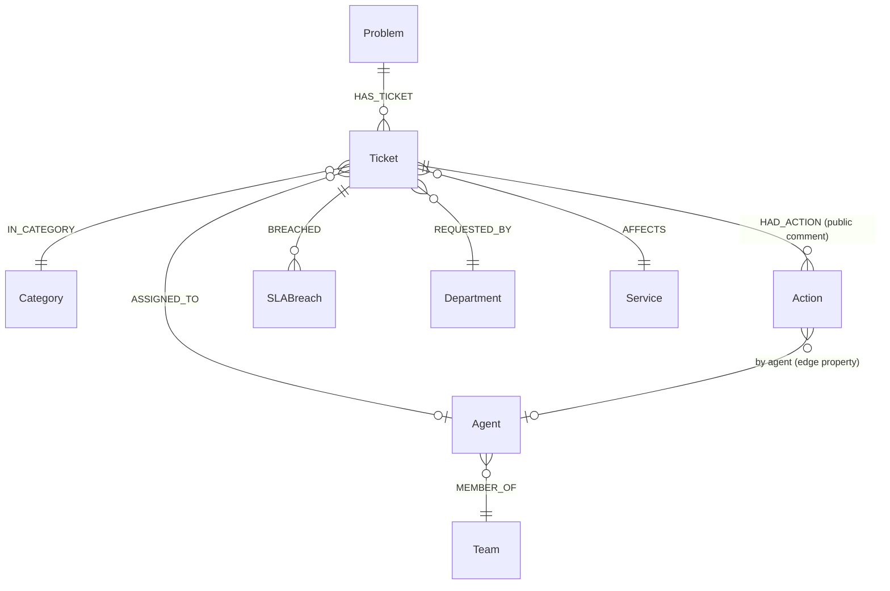

# 03. Graph schema

## Model



### Nodes

| Label | Key | Source | Properties | Approx. count (sample) |
|---|---|---|---|---|
| `Problem` | `key` = normalized summary | `tickets.summary` | `summary`, `ticket_count` (derived), `embedding_ref` (Qdrant point group) | 56 |
| `Ticket` | `ticket_id` | `tickets` | `created_at`, `first_response_at`, `resolved_at`, `priority`, `status`, `channel`, `escalated`, `outage_related`, `hours_to_resolve`, `hours_to_first_response` | 1,000 |
| `Action` | `key` = normalized comment body | `comments.body` | `text` | 24 |
| `Agent` | `agent_id` | `agents` | `name` | 10 |
| `Team` | `name` | `agents.team`, `comments.team` | | 7 |
| `Category` | `category_id` | `categories` | `name` | 8 |
| `Service` | `name` | `categories.service` and `tickets.affected_service` | | 8 |
| `Department` | `name` | `tickets.requester_department` | | 6 |
| `SLABreach` | `breach_id` | `sla_breaches` (matching tickets only) | `breach_type`, `target_hours`, `actual_hours`, `breach_minutes` | 101 |

About 1,200 nodes. No `Reporter`/`Person` node ([finding F6](01-data-analysis.md)).

### Relationships

| Type | From to | Properties | Notes |
|---|---|---|---|
| `HAS_TICKET` | Problem to Ticket | | Hub edge. Every ticket has exactly one. |
| `IN_CATEGORY` | Ticket to Category | | Per ticket, **not** lifted to Problem ([F2](01-data-analysis.md)). |
| `AFFECTS` | Ticket to Service | | |
| `REQUESTED_BY` | Ticket to Department | | |
| `ASSIGNED_TO` | Ticket to Agent | | |
| `HAD_ACTION` | Ticket to Action | `at`, `by_agent_id`, `team` | One edge per public comment. Internal comments are **not loaded** ([ADR-0007](decisions/0007-privacy-and-access.md)). |
| `BREACHED` | Ticket to SLABreach | | |
| `MEMBER_OF` | Agent to Team | | |

### Derived (materialized) edges and properties

These make common questions one hop instead of a scan. Recompute on each load.

| Item | Definition | Used by |
|---|---|---|
| `Problem.ticket_count` | `count{(p)-[:HAS_TICKET]->()}` | "seen N times" |
| `(Problem)-[:COMMONLY_DONE {n, share}]->(Action)` | actions taken on that problem's tickets, with count and share of tickets | "what was done before" |
| `(Problem)-[:CO_OCCURS {jaccard}]->(Problem)` | shared-action similarity, kept only if `jaccard >= 0.4` | "related problems" |

`CO_OCCURS` is the only inferred structure; it is labelled as derived and carries its score so a tool can show it. With 24 actions spread randomly
it will be weakly informative on this data; treat it as a method demo.

## Constraints and indexes (Cypher)

```cypher
CREATE CONSTRAINT problem_key   IF NOT EXISTS FOR (n:Problem)    REQUIRE n.key IS UNIQUE;
CREATE CONSTRAINT ticket_id     IF NOT EXISTS FOR (n:Ticket)     REQUIRE n.ticket_id IS UNIQUE;
CREATE CONSTRAINT action_key    IF NOT EXISTS FOR (n:Action)     REQUIRE n.key IS UNIQUE;
CREATE CONSTRAINT agent_id      IF NOT EXISTS FOR (n:Agent)      REQUIRE n.agent_id IS UNIQUE;
CREATE CONSTRAINT category_id   IF NOT EXISTS FOR (n:Category)   REQUIRE n.category_id IS UNIQUE;
CREATE CONSTRAINT breach_id     IF NOT EXISTS FOR (n:SLABreach)  REQUIRE n.breach_id IS UNIQUE;
CREATE CONSTRAINT team_name     IF NOT EXISTS FOR (n:Team)       REQUIRE n.name IS UNIQUE;
CREATE CONSTRAINT service_name  IF NOT EXISTS FOR (n:Service)    REQUIRE n.name IS UNIQUE;
CREATE CONSTRAINT dept_name     IF NOT EXISTS FOR (n:Department) REQUIRE n.name IS UNIQUE;
CREATE INDEX ticket_created  IF NOT EXISTS FOR (n:Ticket) ON (n.created_at);
CREATE INDEX ticket_priority IF NOT EXISTS FOR (n:Ticket) ON (n.priority);
```

## Load mapping (idempotent `MERGE`)

```cypher
// Problem + Ticket + dimensions, one row per ticket. Parameters come from the Python loader.
UNWIND $rows AS r
MERGE (p:Problem {key: r.problem_key})  ON CREATE SET p.summary = r.summary
MERGE (t:Ticket  {ticket_id: r.ticket_id})
  SET t.created_at = datetime(r.created_at), t.resolved_at = r.resolved_at,
      t.priority = r.priority, t.status = r.status, t.channel = r.channel,
      t.escalated = r.escalated, t.outage_related = r.outage_related,
      t.hours_to_resolve = r.hours_to_resolve, t.hours_to_first_response = r.hours_to_first_response
MERGE (p)-[:HAS_TICKET]->(t)
MERGE (c:Category   {category_id: r.category_id})
MERGE (s:Service    {name: r.affected_service})
MERGE (d:Department {name: r.requester_department})
MERGE (t)-[:IN_CATEGORY]->(c) MERGE (t)-[:AFFECTS]->(s) MERGE (t)-[:REQUESTED_BY]->(d)
FOREACH (_ IN CASE WHEN r.agent_id IS NULL THEN [] ELSE [1] END |
  MERGE (a:Agent {agent_id: r.agent_id}) MERGE (t)-[:ASSIGNED_TO]->(a));
```

Loader rules:

- Batch with `UNWIND` in chunks of 500 rows; one transaction per chunk.
- `problem_key = summary.strip().lower()` with trailing punctuation removed. This must **match the key used by Qdrant's `group_by summary`** so the vector hit and the graph node join exactly. Add a test that every Qdrant summary resolves to a Problem.
- Comments: load only `visibility == "public"`; `Action.key` is the normalized body.
- `sla_breaches`: load rows whose `ticket_id` exists; log the orphan count (expected 1,148 on the sample) rather than creating stub tickets.
- Strip "Reported by <name> from <dept>" from any text that is stored or returned. Descriptions are not stored in the graph at all in phase 1; the Qdrant payload remains the text source.
- After load, count nodes per label and fail the job if they differ from the CSV counts (1,000 tickets, 56 problems, and so on).

## Evolution path

| Trigger | Change |
|---|---|
| Move to full 10k tickets | Same loader; `SLABreach` becomes meaningful; add `Month` bucket property for temporal queries. |
| Real, free-text ticket data with real resolutions | Add LLM extraction of `Symptom`, `RootCause`, `Fix` nodes (see [ADR-0002](decisions/0002-graph-construction.md)); schema above is the stable core. |
| Need one-query hybrid retrieval | Add a Neo4j vector index on `Problem.embedding` (see [ADR-0003](decisions/0003-retrieval-strategy.md)). |
